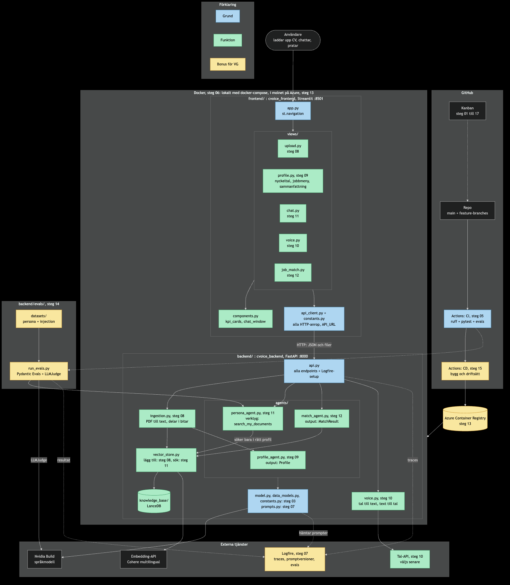

# Architecture

## Overview

- Frontend (Streamlit) talks to the backend (FastAPI) over HTTP.
- The backend ingests documents, stores chunks in a vector store, and runs agents.
- Both services run as their own Docker container: locally with `docker-compose.yaml`, in the cloud on Azure.
- GitHub Actions runs linting, tests and evals on every pull request, and deploys when `main` changes.

## Diagram

"steg 01" to "steg 17" are the steps on the kanban board, in the order we build them. The colours show the foundation (blue), the features (green) and the bonus parts for VG (yellow).

The Mermaid code for the diagram is in [architecture.mmd](architecture.mmd). Change the code there and render a new image when the architecture changes.

## Components

### Backend (`backend/src/cvoice_backend/`)

| Part | Responsibility |
|---|---|
| `api.py` | All endpoints and the Logfire setup. Kept thin: it only calls the functions below |
| `ingestion.py` | PDF to text, split into chunks |
| `vector_store.py` | Store and search chunks in LanceDB, including the embedding model |
| `agents/profile_agent.py` | Build a structured profile |
| `agents/persona_agent.py` | Answer as the person, with a tool that searches only that person's documents |
| `agents/match_agent.py` | Match a profile against a job ad |
| `voice.py` | Speech to text and text to speech |
| `model.py` | The language model, defined once and shared by all agents |
| `prompts.py` | System prompts, versioned in Logfire |
| `data_models.py` | Pydantic models shared by the API and the agents, for example `Profile` |
| `constants.py` | Paths, table names and other fixed values |

### Frontend (`frontend/src/cvoice_frontend/`)

| Part | Responsibility |
|---|---|
| `app.py` | Entry point and navigation between pages |
| `views/upload.py` | Upload CV, cover letter and similar documents |
| `views/profile.py` | KPIs, job dropdown and summary |
| `views/chat.py` | Chat with the persona bot |
| `views/voice.py` | Talk with the persona bot |
| `views/job_match.py` | Match the profile against a job ad |
| `components.py` | Reusable UI parts: KPI cards and the chat window |
| `api_client.py` | Every HTTP call to the backend, in one place |
| `constants.py` | `API_URL` and other fixed values |

### Evals (`backend/evals/`)

| Part | Responsibility |
|---|---|
| `datasets/` | Test cases: does the bot answer as the person, and can it be tricked (prompt injection)? |
| `run_evals.py` | Runs the cases with Pydantic Evals, uses `LLMJudge` to grade the answers and sends the results to Logfire |

## Data flows

**Upload**
1. The user uploads documents in `views/upload.py`.
2. `api_client.py` sends the files to the backend.
3. `ingestion.py` turns them into text and splits the text into chunks.
4. `vector_store.py` stores the chunks in LanceDB, tagged with the profile id.
5. `profile_agent` reads the text and returns a `Profile` (KPIs, jobs, summary).

**Chat**
1. The user writes a question in `views/chat.py`.
2. The backend passes it to `persona_agent`, together with the chat history.
3. The agent searches the person's chunks in `vector_store.py` and answers as the person.

**Voice**
1. The user records a question in `views/voice.py`.
2. `voice.py` turns the speech into text.
3. The text goes through the same chat flow as above.
4. `voice.py` turns the answer back into speech.

**Job match**
1. The user pastes a job ad in `views/job_match.py`.
2. `match_agent` compares it with the profile and returns a `MatchResult`.

## Storage

LanceDB stores its data in `backend/knowledge_base/`. In Docker the folder is mounted as a volume, so the data survives when the container restarts. The folder is not committed.

## External services

| Service | Used for | Environment variable |
|---|---|---|
| Language model | All agents and the LLM judge | `LLM_API_KEY` |
| Embedding model | Turning chunks and questions into vectors | `EMBEDDING_API_KEY` |
| Speech API | Speech to text and text to speech | Chosen later |
| Logfire | Traces, prompt versions and eval results | `LOGFIRE_TOKEN` |

All keys live in `.env`, which is never committed. `.env.example` lists the names without values.

## Deployment

- **Locally:** `docker compose up --build` starts the backend on port 8000 and the frontend on port 8501. Inside Docker the frontend reaches the backend at `http://backend:8000`.
- **CI:** on every pull request GitHub Actions runs ruff, pytest and the evals.
- **CD:** when `main` changes, GitHub Actions builds both images, pushes them to Azure Container Registry and deploys them on Azure.
